# Ejercio 3 — MetaMask y red de pruebas Ethereum Sepolia

> **Asignatura:** Blockchain  
> **Fecha:** 26 de octubre de 2026  
> **Entorno:** MetaMask (extensión de navegador), Ethereum Sepolia, Google Cloud Web3 Faucet y Sepolia Etherscan.

## 1. Objetivos

Esta práctica tiene como finalidad aprender a configurar una cartera de Ethereum con **MetaMask**, habilitar una red de pruebas, solicitar ETH de prueba mediante un _faucet_, comprobar las operaciones en un explorador de bloques y efectuar una transferencia entre dos direcciones.

**Importante:** Sepolia es una red de pruebas. Su ETH no tiene valor económico real y no debe confundirse con el ETH de Ethereum Mainnet.

## 2. Preparación de MetaMask

### Paso 1. Acceder al asistente de instalación

Se abre la extensión de MetaMask, que ofrece crear una cartera nueva o importar una existente. Para una práctica se puede utilizar una cartera de pruebas independiente.

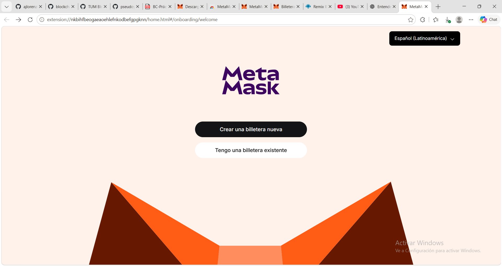

### Paso 2. Finalizar la configuración inicial

Tras completar el asistente de creación y protección de la cartera, MetaMask confirma que está lista. La frase de recuperación debe guardarse **fuera del repositorio**, sin publicarla ni compartirla.

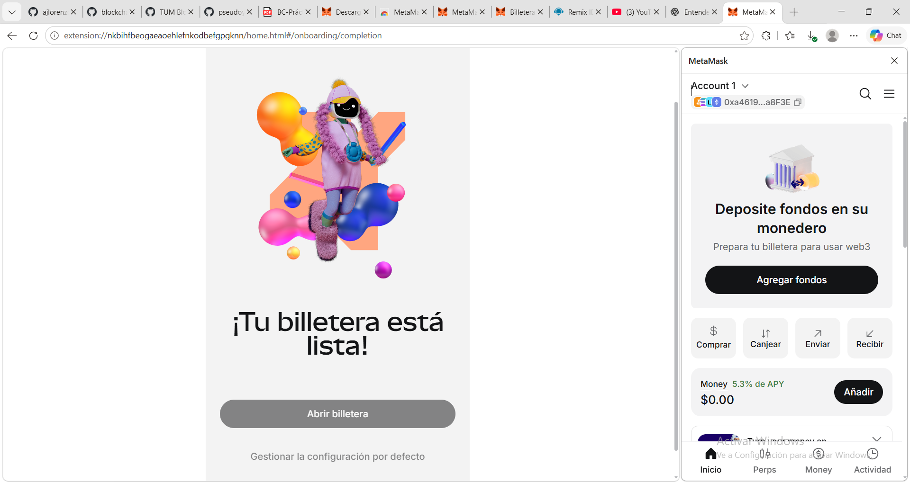

### Paso 3. Acceder a las opciones de administración

Desde el menú de MetaMask se accede a las funciones de gestión de la cartera. En este menú se encuentra la sección **Redes**.

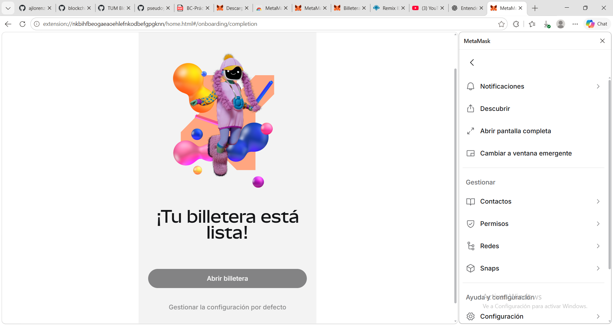

### Paso 4. Abrir el administrador de redes

En **Administrar redes** se muestran las redes predeterminadas, como Ethereum, Linea, Base, Arbitrum o Polygon. La red de pruebas Sepolia se encuentra más abajo.

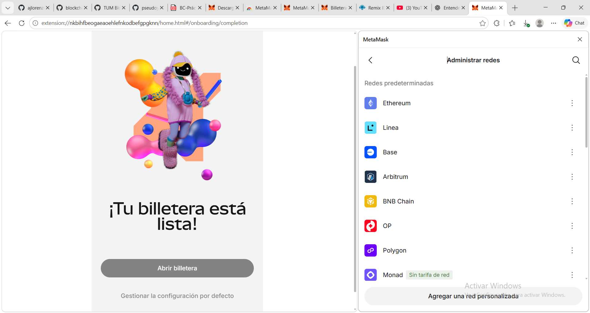

### Paso 5. Habilitar las redes de prueba

Se activa el interruptor **Mostrar redes de prueba**. Con ello aparece **Sepolia** entre las redes disponibles. Es importante distinguir **Sepolia** de **Linea Sepolia**, pues son redes diferentes.

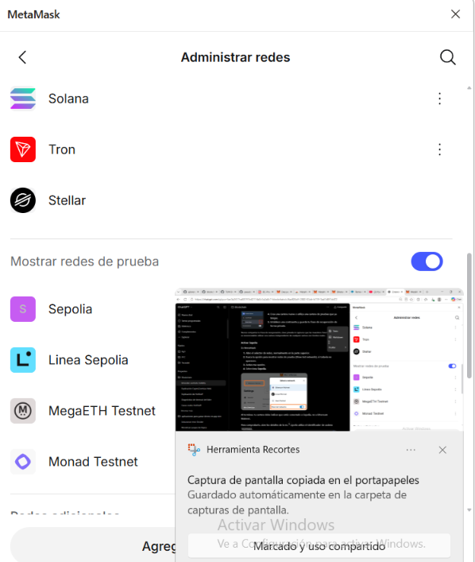

## 3. Obtener ETH de prueba

### Paso 6. Abrir Google Cloud Web3 Faucet

Se accede al [faucet de Ethereum Sepolia de Google Cloud](https://cloud.google.com/application/web3/faucet/ethereum/sepolia), se selecciona **Ethereum Sepolia** y se introduce la dirección pública de la cartera receptora (**Account 1**):

```text
0xa4619773E2aD0f27458085eAD192FA4C637a8F3E
```

Esta dirección es pública; **no** debe confundirse con una clave privada o frase de recuperación.

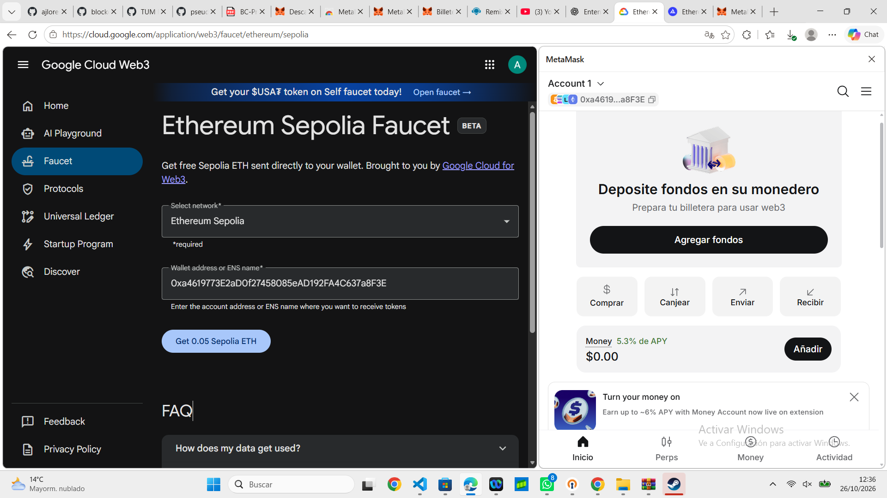

### Paso 7. Solicitar 0,05 Sepolia ETH

Se pulsa **Get 0.05 Sepolia ETH** para solicitar fondos gratuitos. El formulario mostrado por sí solo no demuestra que el envío se haya realizado: la confirmación se obtiene al consultar la cadena de bloques.

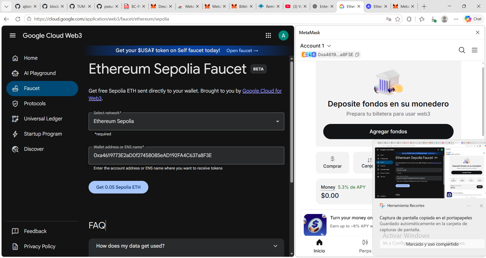

### Paso 8. Verificar la recepción en Sepolia Etherscan

Se consulta la dirección en [Sepolia Etherscan](https://sepolia.etherscan.io/address/0xa4619773E2aD0f27458085eAD192FA4C637a8F3E). El explorador muestra **0,05 ETH de saldo** y una transacción de entrada de **0,05 ETH**. Esto confirma que la cuenta recibió los fondos.

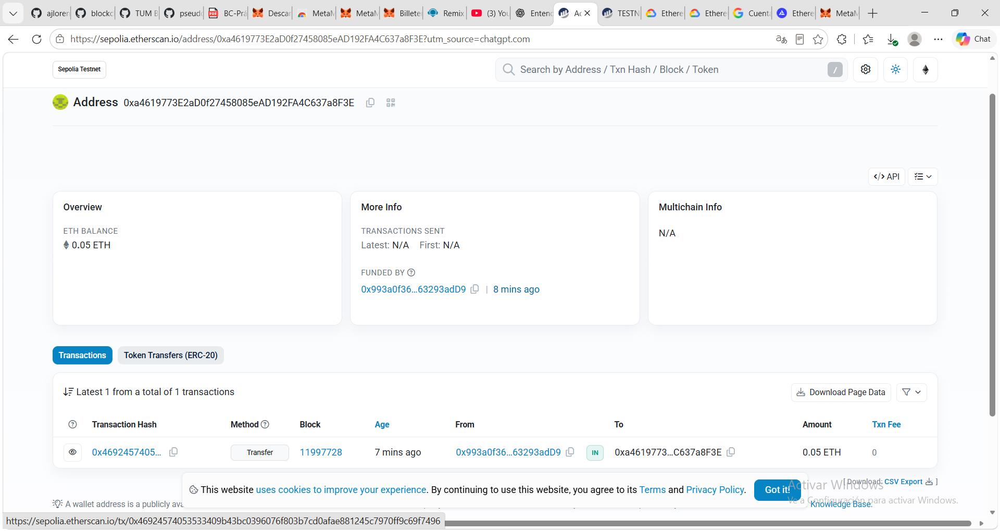

## 4. Comprobar y ajustar la configuración de Sepolia

### Paso 9. Revisar los parámetros de red

Se abre la edición de Sepolia y se comprueban los siguientes valores:

| Campo                    | Valor                                                            |
| ------------------------ | ---------------------------------------------------------------- |
| Nombre                   | Sepolia                                                          |
| RPC                      | `https://ethereum-sepolia-rpc.publicnode.com`                    |
| Chain ID                 | `11155111`                                                       |
| Símbolo de moneda nativa | `ETH` o etiqueta `SepoliaETH` según la configuración de MetaMask |
| Explorador               | `https://sepolia.etherscan.io`                                   |

El identificador **11155111** permite verificar que se utiliza la red de pruebas Ethereum Sepolia. En las capturas MetaMask advierte sobre el símbolo `ETH` y sugiere `SepoliaETH`; esto es una cuestión de etiqueta de presentación, no un cambio de blockchain.

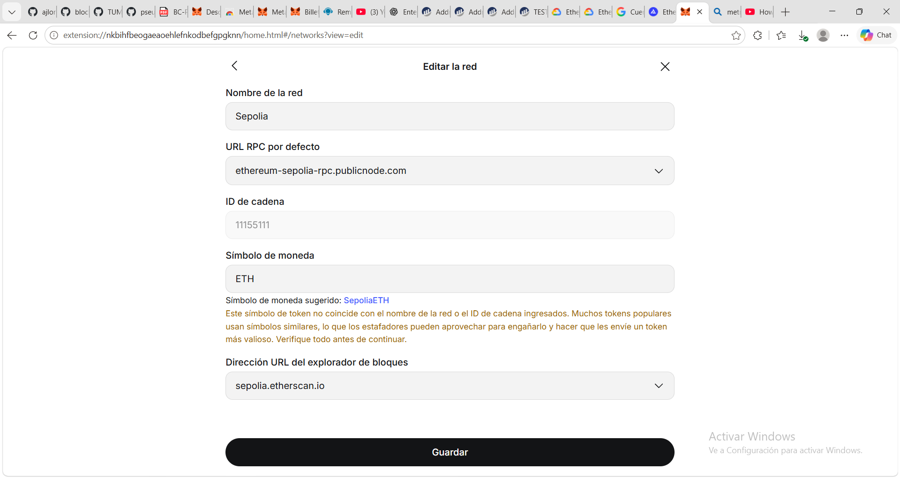

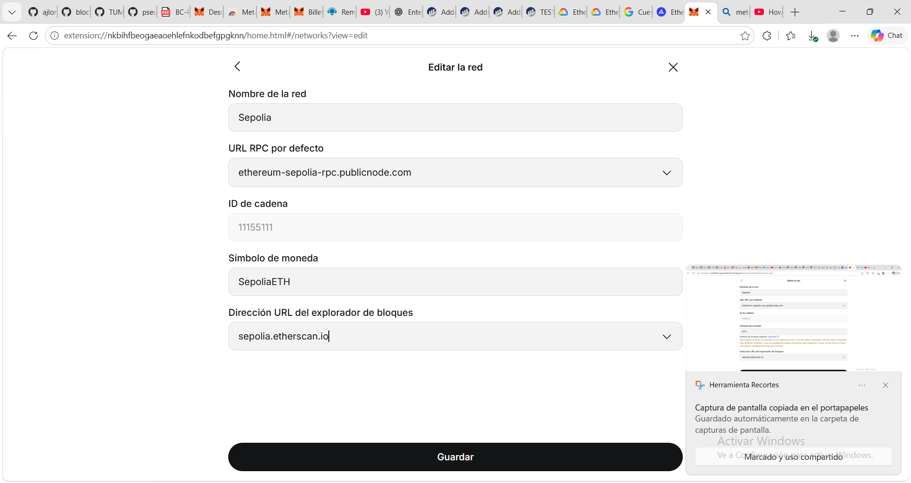

### Paso 10. Consultar ChainList

Se abre [ChainList para Ethereum Sepolia](https://chainlist.org/chain/11155111), donde se puede contrastar el **Chain ID 11155111**, la moneda **ETH** y los enlaces de exploradores/RPC. No es necesario agregar una segunda red con el mismo Chain ID si Sepolia ya existe en MetaMask.

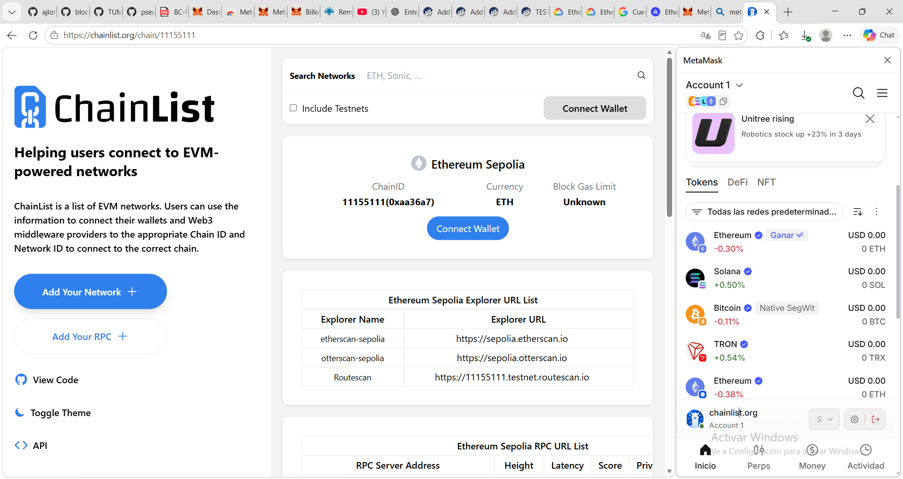

### Paso 11. Mostrar el saldo en MetaMask

En la pantalla **Inicio → Tokens**, se filtra por **Red: Sepolia**. MetaMask muestra **0,0500 SepoliaETH** en Account 1. Aunque el valor en dólares sea **USD 0,00**, los ETH de prueba sí están disponibles.

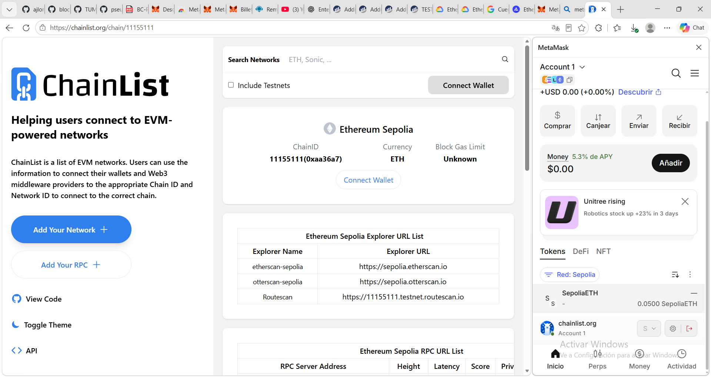

## 5. Enviar una transacción de prueba

### Paso 12. Preparar la transferencia

Desde **Account 1**, se pulsa **Enviar**, se selecciona como destinataria **Account 2** (`0x4e739...1d4a0`, dirección abreviada en la captura) y se indica una cantidad de **0,0001 SepoliaETH**. Antes de continuar se comprueba que la red sea Sepolia y que la dirección de destino sea correcta.

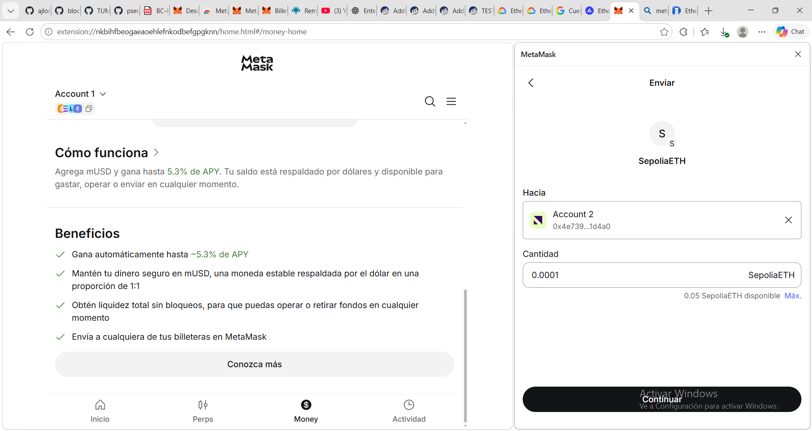

### Paso 13. Revisar el resumen de envío

MetaMask muestra la cuenta de origen, la cuenta de destino, la red y la estimación de comisión. Esta pantalla permite comprobar la operación antes de autorizarla.

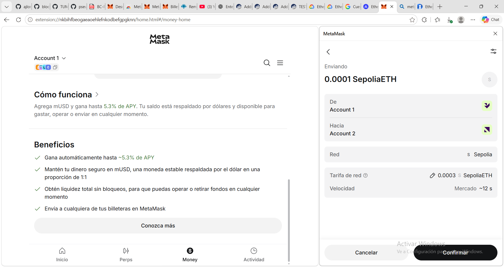

### Paso 14. Confirmar la operación

La captura muestra:

- **Cantidad:** 0,0001 SepoliaETH.
- **Origen:** Account 1.
- **Destino:** Account 2.
- **Red:** Sepolia.
- **Tarifa estimada:** aproximadamente 0,0003 SepoliaETH.

Se pulsa **Confirmar** para emitir la transacción. La comisión es variable y la cantidad final debe consultarse en el recibo de la operación.


### Paso 15. Comprobar el saldo de Account 1

Después de la operación, la captura muestra **0,0496 SepoliaETH** en Account 1. La reducción es coherente con el importe transferido más una comisión de red cercana a la estimación presentada.

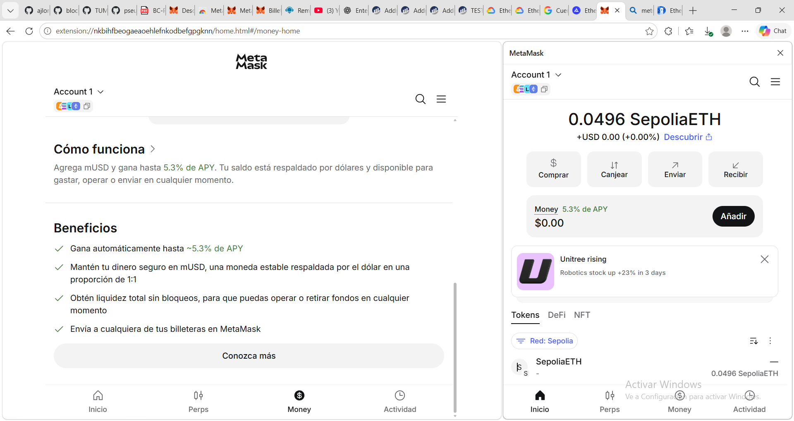


### Paso 16. Comprobar el saldo de Account 2

Se cambia a **Account 2** y se observa **0,000100 SepoliaETH**, correspondiente a la cantidad enviada desde Account 1. Esta captura acredita la recepción en la segunda cuenta.

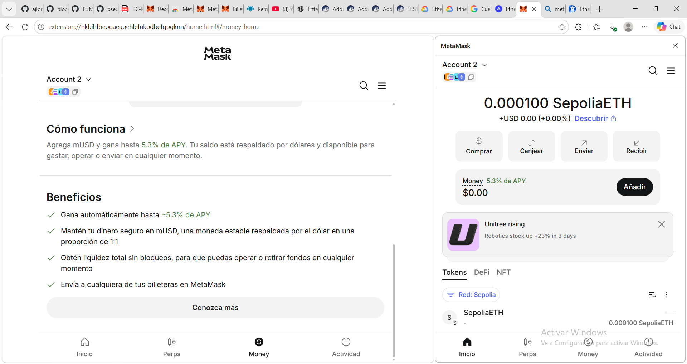
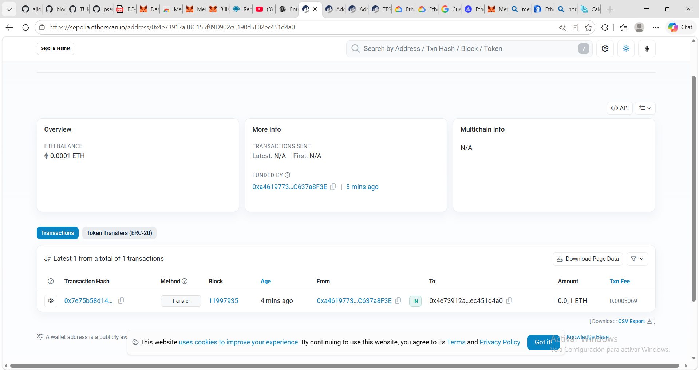

> **Verificación adicional recomendada:** para documentar de forma completa el envío, abrir **Actividad → transferencia realizada → Ver en explorador** y guardar una captura con el hash, estado `Success`, bloque, origen, destino y tarifa real. Las capturas incluidas prueban el saldo recibido, pero no muestran todavía el hash de esta segunda transacción.

## 6. Resultados

| Comprobación              | Resultado observado                           |
| ------------------------- | --------------------------------------------- |
| Cartera configurada       | MetaMask disponible con Account 1 y Account 2 |
| Red de pruebas            | Ethereum Sepolia (`11155111`)                 |
| Fondos solicitados        | 0,05 SepoliaETH                               |
| Recepción verificada      | 0,05 ETH en Sepolia Etherscan                 |
| Transferencia preparada   | 0,0001 SepoliaETH de Account 1 a Account 2    |
| Comisión estimada         | ≈ 0,0003 SepoliaETH                           |
| Saldo posterior Account 1 | 0,0496 SepoliaETH                             |
| Saldo posterior Account 2 | 0,000100 SepoliaETH                           |

## 7. Conclusiones

La práctica demuestra el uso de una cartera EVM y una red pública de pruebas para realizar operaciones sin utilizar criptomonedas de valor real. Se ha comprobado que **la dirección de la cuenta**, **la red seleccionada** y **el explorador correspondiente** deben coincidir para interpretar correctamente los saldos. Asimismo, se observa que una transferencia consume una **comisión de gas**, pagada por la cuenta emisora, adicional a la cantidad recibida por la cuenta destinataria.

## 8. Recursos utilizados

- [MetaMask](https://metamask.io/)
- [Google Cloud Web3 — Ethereum Sepolia Faucet](https://cloud.google.com/application/web3/faucet/ethereum/sepolia)
- [Sepolia Etherscan — cuenta de la práctica](https://sepolia.etherscan.io/address/0xa4619773E2aD0f27458085eAD192FA4C637a8F3E)
- [ChainList — Ethereum Sepolia (11155111)](https://chainlist.org/chain/11155111)
